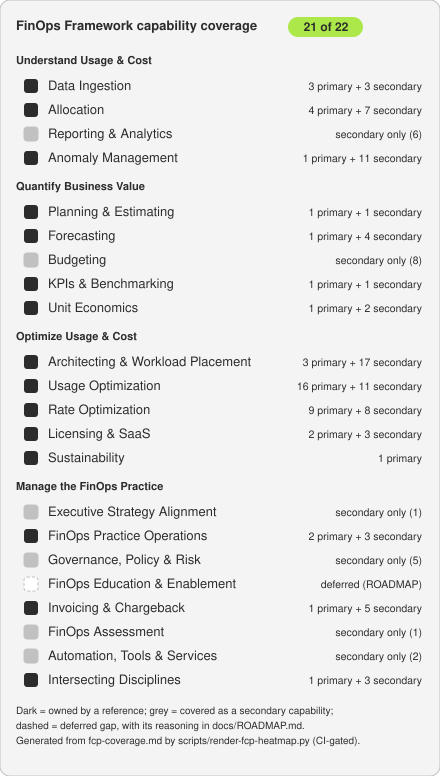
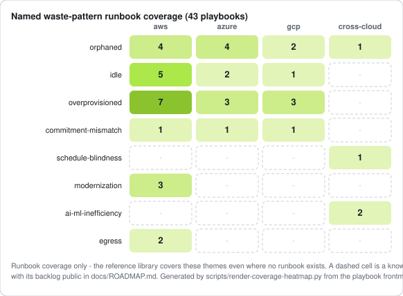

<picture>
  <source media="(prefers-color-scheme: dark)" srcset="assets/optimnow-logo-dark.png">
  
</picture>

# Cloud FinOps by OptimNow

> FinOps knowledge for AI assistants: billing mechanics, commitment decisions and waste runbooks for AWS, Azure, GCP, AI and data platforms. By OptimNow.

Ask your assistant how to reduce a cloud bill, size a commitment, read a term sheet
or allocate shared AI costs, and it answers from how billing works, with decision
rules and worked examples, instead of general advice. The same files work in Claude,
ChatGPT, Gemini, Cursor and any MCP-compatible tool. Open source, written by
[OptimNow](https://www.optimnow.io/?utm_source=github&utm_medium=readme&utm_campaign=cloud-finops)
from enterprise FinOps delivery, and aligned with the FinOps Foundation framework.

---

## What you can ask, by role

Each question below is answered by a file that exists in this repository today.

**FinOps lead**

- "Which of our Savings Plans and reservations expire in the next 90 days, and what should we decide before they do?" ([aws-expiring-commitment-no-decision](plugins/cloud-finops/skills/cloud-finops/playbooks/aws-expiring-commitment-no-decision.md), [azure-unused-reservation](plugins/cloud-finops/skills/cloud-finops/playbooks/azure-unused-reservation.md), [finops-aws-commitments.md](plugins/cloud-finops/skills/cloud-finops/references/finops-aws-commitments.md))
- "A third of our bill is unallocated. How do we reach a defensible allocation of shared costs?" ([finops-allocation-showback.md](plugins/cloud-finops/skills/cloud-finops/references/finops-allocation-showback.md))
- "Who should own commitment purchases, and which meetings do we need to run the practice?" ([finops-practice-operations.md](plugins/cloud-finops/skills/cloud-finops/references/finops-practice-operations.md))

**Finance and procurement**

- "Our AWS enterprise agreement renews in 6 months. What should we check on the term sheet before signing?" ([finops-cloud-contracts.md](plugins/cloud-finops/skills/cloud-finops/references/finops-cloud-contracts.md))
- "Finance wants a 12-month cloud forecast with an accuracy target. Which measures do we report, and how tight should the band be at our maturity?" ([finops-forecasting.md](plugins/cloud-finops/skills/cloud-finops/references/finops-forecasting.md))
- "What has to be true in Finance and in the ERP before we move from showback to chargeback?" ([finops-chargeback.md](plugins/cloud-finops/skills/cloud-finops/references/finops-chargeback.md))

**Engineering and platform**

- "Our NAT gateway bill is higher than the compute it serves. Where does it come from and what do we change?" ([aws-nat-gateway-endpoint-substitution](plugins/cloud-finops/skills/cloud-finops/playbooks/aws-nat-gateway-endpoint-substitution.md), [aws-zombie-nat-gateway](plugins/cloud-finops/skills/cloud-finops/playbooks/aws-zombie-nat-gateway.md))
- "How do we split the cost of a shared Kubernetes cluster between teams?" ([finops-kubernetes.md](plugins/cloud-finops/skills/cloud-finops/references/finops-kubernetes.md))
- "Our Log Analytics ingestion doubled. Which tables and which settings do we check first?" ([azure-log-analytics-sprawl](plugins/cloud-finops/skills/cloud-finops/playbooks/azure-log-analytics-sprawl.md), [finops-azure.md](plugins/cloud-finops/skills/cloud-finops/references/finops-azure.md))

**AI product owner**

- "We spend $40K a month on Bedrock and do not know which features it goes to. Where do we start?" ([finops-bedrock.md](plugins/cloud-finops/skills/cloud-finops/references/finops-bedrock.md))
- "Should we buy provisioned throughput or stay pay-as-you-go for 500K requests a day?" ([finops-genai-capacity.md](plugins/cloud-finops/skills/cloud-finops/references/finops-genai-capacity.md), [finops-azure-openai.md](plugins/cloud-finops/skills/cloud-finops/references/finops-azure-openai.md))
- "Our AI coding tool spend tripled in 6 months. How do we control it without banning the tools?" ([finops-ai-dev-tools.md](plugins/cloud-finops/skills/cloud-finops/references/finops-ai-dev-tools.md))

Neither the skill nor the connector can see your cloud account. For a question about
your own resources, the answer is a detection query you run yourself, taken from the
matching runbook.

---

## What it covers

### The FinOps Framework

The reference library is mapped to the 22 capabilities of the FinOps Foundation
framework, grouped in its 4 domains. A filled square means at least one reference
owns the capability; a grey square means the capability is covered inside another
file; a dashed square is a known gap, listed with its reasoning in
[docs/ROADMAP.md](docs/ROADMAP.md).

This map is generated from the frontmatter of every reference file, and the CI
pipeline fails when the committed map no longer matches the files
([fcp-coverage.md](fcp-coverage.md)).

### Providers and business needs

The matrix reads the library by business need. Every cell comes from a named
reference file, listed in the notes under the tables.

| Level | Meaning |
|---|---|
| ● deep | A dedicated reference or section, with decision rules, worked examples or detection queries |
| ◐ partial | Covered inside a broader file, or mechanics only |
| – | Not covered today |
| n/a | The combination does not exist |

<!-- business-coverage:start -->
**Hyperscalers**

| Business need | AWS | Azure | GCP |
|---|:-:|:-:|:-:|
| Understand and allocate the bill | ● | ● | ● |
| Budget and forecast | ● | ● | ● |
| Commitments and discounts | ● | ● | ● |
| Contract negotiation and renewal | ● | ● | ● |
| Reduce waste | ● | ● | ● |
| AI and GenAI spend | ● | ● | ● |
| Data platforms | ◐ | ● | ◐ |
| SaaS and licences | ◐ | ◐ | ◐ |
| Carbon footprint | ● | ◐ | ◐ |

**Other estates**

| Business need | OCI | On-prem |
|---|:-:|:-:|
| Understand and allocate the bill | ◐ | ● |
| Budget and forecast | ◐ | ◐ |
| Commitments and discounts | ◐ | ◐ |
| Contract negotiation and renewal | – | – |
| Reduce waste | ◐ | ◐ |
| AI and GenAI spend | – | ◐ |
| Data platforms | – | – |
| SaaS and licences | – | ◐ |
| Carbon footprint | – | – |

**Platforms**

| Business need | AI | Data | SaaS |
|---|:-:|:-:|:-:|
| Understand and allocate the bill | ● | ● | ◐ |
| Budget and forecast | ● | ◐ | ◐ |
| Commitments and discounts | ● | ● | ◐ |
| Contract negotiation and renewal | – | ◐ | ◐ |
| Reduce waste | ● | ● | ● |
| AI and GenAI spend | ● | ◐ | ● |
| Data platforms | n/a | ● | n/a |
| SaaS and licences | ◐ | ◐ | ● |
| Carbon footprint | – | – | – |
<!-- business-coverage:end -->

On-prem covers owned data centres and the hybrid platforms (Outposts, Azure Local,
Arc). AI covers the AI platforms: Anthropic, AWS Bedrock, Azure OpenAI, GCP Vertex AI
and the open-weight vendor APIs. Data covers Databricks, Snowflake and Microsoft
Fabric. SaaS covers SaaS applications, AI coding tools and licences.

Where each cell comes from

All paths are under `plugins/cloud-finops/skills/cloud-finops/`.

- **Understand and allocate the bill.** AWS: `references/finops-aws-billing.md`, `finops-allocation-showback.md`, `finops-focus.md`, `finops-tagging.md`. Azure: `finops-azure-billing.md`, `finops-focus.md`, `finops-tagging.md`. GCP: `finops-gcp.md` (cost data foundation), `finops-focus.md`, `finops-kubernetes.md`. OCI, partial: `finops-oci.md` (cost reports, cost-tracking tags), `finops-focus.md`. On-prem: `finops-on-prem-hybrid.md` (internal bill, usage ingestion). AI platforms: the "Cost visibility and allocation" sections of `finops-bedrock.md`, `finops-azure-openai.md`, `finops-vertexai.md`, `finops-anthropic.md`; `finops-for-ai.md`. Data platforms: `finops-databricks.md` (system tables, allocation), `finops-fabric.md` (shared-capacity allocation), `finops-snowflake.md` (query attribution). SaaS, partial: `finops-sam.md` (discovery), `finops-focus.md` (FOCUS for SaaS vendors), `finops-ai-dev-tools.md` (attribution patterns).
- **Budget and forecast.** AWS and Azure: `finops-forecasting.md`, `finops-anomaly-management.md`, and the Budgets sections of `finops-aws-billing.md` and `finops-azure-billing.md`. GCP: `finops-gcp.md` (budgets, spend caps), `finops-anomaly-management.md`. OCI, partial: `finops-oci.md` (Budgets). On-prem, partial: `finops-on-prem-hybrid.md` (rate setting); capacity planning is on the roadmap. AI platforms: `finops-ai-value-management.md` (AI investment budgets, stage gates), `finops-forecasting.md` (AI forecast scenarios), `finops-anthropic.md` (spend limits). Data platforms, partial: budget controls in `finops-snowflake.md`, `finops-databricks.md`, `finops-fabric.md`. SaaS, partial: `finops-sam.md` (renewal calendar, metrics), `finops-ai-dev-tools.md` (spending caps).
- **Commitments and discounts.** AWS: `finops-aws-commitments.md`, `finops-aws-patterns-databases.md` (database commitment tree), `playbooks/aws-expiring-commitment-no-decision.md`. Azure: `finops-azure-commitments.md`, `playbooks/azure-unused-reservation.md`. GCP: `finops-gcp.md` (CUDs, BigQuery commitments), `finops-vertexai.md` (Flexible Savings Plans), `playbooks/gcp-cud-mismatch.md`. OCI, partial: `finops-oci.md` (Universal Credits). On-prem, partial: `finops-on-prem-hybrid.md` (hybrid platform terms: Outposts, Exadata Cloud@Customer). AI platforms: `finops-genai-capacity.md`, provisioned capacity in `finops-azure-openai.md`, `finops-bedrock.md`, `finops-vertexai.md`. Data platforms: `finops-databricks.md` (committed-use bands), `finops-snowflake.md` (capacity model), `finops-fabric.md` (reservation). SaaS, partial: `finops-ai-dev-tools.md` (plan tiers), `finops-sam.md` (multi-year agreements).
- **Contract negotiation and renewal.** AWS, Azure, GCP: `finops-cloud-contracts.md`, plus `finops-azure-billing.md` (EA-to-MCA). Data platforms, partial: the data platform section of `finops-cloud-contracts.md`, `finops-databricks.md`, `finops-snowflake.md`. SaaS, partial: `finops-sam.md` (renewal governance), `finops-itam.md` (pre-renewal checkpoint, joint negotiation). OCI, on-prem and AI platforms: no file. See "Contract negotiation and renewal" below.
- **Reduce waste.** AWS: `finops-aws.md`, the 5 `finops-aws-patterns-*.md` files, 22 runbooks. Azure: `finops-azure.md`, `finops-azure-patterns.md`, 10 runbooks. GCP: the pattern catalogue inside `finops-gcp.md`, 7 runbooks. OCI, partial: `finops-oci.md` (6 patterns, no runbook). On-prem, partial: `finops-on-prem-hybrid.md` (idle capacity line, cost score). AI platforms: `finops-for-ai.md` (anti-patterns), `finops-genai-capacity.md` (provisioned-capacity waste), the optimisation sections of the 4 AI platform files, 2 cross-cloud runbooks. Data platforms: the pattern sections of `finops-databricks.md`, `finops-snowflake.md`, `finops-fabric.md`. SaaS: `finops-sam.md` (sprawl patterns), `finops-ai-dev-tools.md` (optimisation levers).
- **AI and GenAI spend.** AWS: `finops-bedrock.md`, `finops-aws.md` (SageMaker), the GPU and SageMaker runbooks. Azure: `finops-azure-openai.md`. GCP: `finops-vertexai.md`. On-prem, partial: `finops-ai-self-hosted-vs-managed.md`. AI platforms: `finops-for-ai.md`, `finops-agentic.md`, `finops-ai-value-management.md`, `finops-genai-capacity.md`, `finops-anthropic.md`, `finops-open-weight-vendors.md`. Data platforms, partial: Cortex in `finops-snowflake.md`, model serving in `finops-databricks.md`. SaaS: `finops-ai-dev-tools.md`, `playbooks/cross-cloud-coding-agent-token-waste.md`.
- **Data platforms.** AWS, partial: `finops-databricks.md` on AWS, Redshift commitments in `finops-aws-patterns-databases.md`. Azure: `finops-fabric.md`, `finops-databricks.md`. GCP, partial: BigQuery in `finops-gcp.md`. Data platforms: `finops-databricks.md`, `finops-snowflake.md`, `finops-fabric.md`.
- **SaaS and licences.** AWS, Azure, GCP, partial: marketplace channel governance in `finops-itam.md`, Marketplace private offers in `finops-cloud-contracts.md`, Azure Hybrid Benefit in `finops-azure-commitments.md`. On-prem, partial: VMware core licensing in `finops-on-prem-hybrid.md`, BYOL in `finops-itam.md`. AI platforms, partial: licensing in `finops-open-weight-vendors.md`. Data platforms, partial: Pro, PPU and F-SKU licences in `finops-fabric.md`. SaaS: `finops-sam.md`, `finops-itam.md`, `finops-ai-dev-tools.md`.
- **Carbon footprint.** AWS: `greenops-cloud-carbon.md` (Sustainability Console, Well-Architected pillar). Azure and GCP, partial: the same file, with the Azure and GCP depth pass on the roadmap; `finops-gcp.md` (Cloud Carbon Footprint).

### Contract negotiation and renewal

The reference [finops-cloud-contracts.md](plugins/cloud-finops/skills/cloud-finops/references/finops-cloud-contracts.md)
covers negotiated spend commitments with the 3 hyperscalers: AWS Private Pricing
(EDP and PPA), Azure MACC and the Azure Commitment Discount, and Google Cloud Minimum
Commitment. It describes the 12 clauses of an enterprise agreement, where the discount
shows in billing data, migration funding (MAP, Azure Accelerate, RaMP), Marketplace
private offers as a commitment lever, the reseller channel, 9 intake questions to ask
before advising, a 15-point review grid for a term sheet, the usual pitfalls and the
timing of a renewal. A closing section covers Databricks and Snowflake commitments
inside a cloud contract. Benchmarks come from public sources named in the file; the
library carries no observed contract figure.

Also covered: SaaS renewal governance (renewal calendar, auto-renewal review) in
[finops-sam.md](plugins/cloud-finops/skills/cloud-finops/references/finops-sam.md) and
the pre-renewal checkpoint and marketplace channel governance in
[finops-itam.md](plugins/cloud-finops/skills/cloud-finops/references/finops-itam.md).

Not covered today: negotiation with AI providers (Anthropic, OpenAI and the hosted
model vendors; the library covers their reservation mechanics, not their enterprise
agreements), OCI Universal Credits beyond their mechanics, and colocation or hosting
contracts.

### Waste runbooks

A runbook is a step-by-step procedure for one specific waste pattern: the symptoms, a
detection query you run in your own account, the fix in safest-first order, and the
mistake to avoid. The library files them by provider and by waste category, and each
one carries a confidence level that says whether a single signal is enough to act.

---

## What it does not do

- **Live prices.** The files carry billing mechanics, which stay true for years. Price
  figures go stale inside a packaged skill within weeks, so they are left out. For a
  current price the skill points to [OptimToken](https://optimtoken.optimnow.io),
  OptimNow's free comparison of LLM token rates and compute instance rates, each
  figure with its as-of date.
- **Your cloud account.** Nothing here reads a bill or an API. For "which of my
  resources" questions, the deliverable is the runbook's detection query.
- **Legal, tax or accounting advice.** The contract and chargeback references describe
  mechanics and the questions to ask; your counsel, tax adviser and auditors decide.
- **Topics still open.** Accounting for owned capacity (depreciation, lease treatment),
  AI provider and OCI contract negotiation, and the FinOps Education & Enablement
  capability. Each is listed in [docs/ROADMAP.md](docs/ROADMAP.md) with the trigger
  that would reopen it.
- **Guaranteed routing.** The model decides which file to read. When an answer arrives
  without a visible file read or tool call, ask for the library by name ("check the
  playbook library"). See [docs/CONCEPTS.md](docs/CONCEPTS.md).

---

## Install

| Tool | One-step install |
|---|---|
|  | At the Claude Code prompt: `/plugin marketplace add https://github.com/OptimNow/cloud-finops-skills.git` then `/plugin install cloud-finops@optimnow`. The plugin is the skill only; for the 6 retrieval tools, add the hosted MCP connector separately (row below) |
|  | [Install from the Claude directory](https://claude.ai/customize/plugins/id/9d1f1714-07ca-4cb4-b658-bddba8f2ec92%40anthropic-plugin-directory) (one click, kept current from this repository). Or [download the latest release zip](https://github.com/OptimNow/cloud-finops-skills/releases/latest), then **Settings -> Skills -> Upload zip** |
|  | Self-host: `./install.sh --tool chatgpt --grouped` _(a public Cloud FinOps GPT is on the Roadmap)_ |
|  | Self-host: `./install.sh --tool gemini` _(a public Cloud FinOps Gem is on the Roadmap)_ |
|        | One-liner: `curl -sL https://raw.githubusercontent.com/OptimNow/cloud-finops-skills/main/install.sh \| bash -s -- --tool <name>` |
|  | `curl -sL https://raw.githubusercontent.com/OptimNow/cloud-finops-skills/main/install.sh \| bash` |
|  | Nothing to install: `claude mcp add --transport http cloud-finops https://mcp.optimnow.io/mcp`. For Claude.ai / Desktop, **Settings -> Connectors -> Add custom connector** with exactly that URL (exactly that form, `/mcp` with no trailing slash - the widget sandbox domain is derived from it) |
|  | `pip install cloud-finops-mcp` then add to your MCP client config (Claude Code / Cursor / Codex / Windsurf / Cline). Snippets: `./install.sh --tool mcp` |

Full options, troubleshooting, and the model-agnostic API loader: see
[INSTALLATION.md](./INSTALLATION.md). A version-tagged zip
(`cloud-finops-vX.Y.Z.zip`) is attached to every
[GitHub release](https://github.com/OptimNow/cloud-finops-skills/releases).

---

## How it works

- **The skill** is a folder of markdown files: an entry point that routes a question
  to the right reference, the reference library and the runbooks. Installed in Claude,
  Kiro or through the installer for other tools, the guidance sits in the model's
  context before it answers. No code runs, no data leaves your machine.
- **The MCP connector** serves the same library the other way round, as 6 read-only
  tools the model calls when it decides to: list, search by FinOps capability or
  waste category, and fetch one reference or runbook. One URL to paste
  (`https://mcp.optimnow.io/mcp`), nothing to install. Tool calls go to a server
  OptimNow runs in Paris; see "Data handling" below.
- **The plugin** in the Claude directory is the skill only. The connector is a
  separate listing, so that the same content is not loaded twice in one session.
- **Live prices** come from [OptimToken](https://optimtoken.optimnow.io), queried at
  answer time, never copied into these files.

The 2 delivery shapes behave differently: a loaded skill grounds advisory and
symptom questions without a decision to make, while the connector depends on the
model choosing to call a tool. What that means in practice, and when to use both,
is in [docs/CONCEPTS.md](docs/CONCEPTS.md). Using a non-Claude model through an API,
add the response contract from [INSTALLATION.md](./INSTALLATION.md) to your system
prompt so answers stay structured and billing-grounded.

---

## Usage examples

  <a href="https://www.loom.com/share/cc76d419adc64b1784e58621d6934d3e">
    
Cloud FinOps skill - Watch Video

  </a>
  

More questions the library is written to answer, beyond the role list above:

- "Our monthly bill jumped from $12K to $38K after a developer enabled Fast mode in Claude Code. How do I get this under control?"
- "Should we self-host an open-weight model on rented H100s instead of paying per token, and what hidden costs do TCO calculators miss?"
- "Our client wants separate AWS invoices per business unit. Their AWS contact suggested Cost Categories. Is that right?"
- "We are migrating from EA to MCA. What FinOps work do we need to do before the switch?"
- "We need to start reporting our cloud carbon emissions. Where do we begin?"
- "Our Snowflake bill doubled in a quarter. Is it the warehouses, storage or Cortex, and what do we check first?"
- "We run half our workloads in our own data centres. How do we give app teams a monthly bill for on-prem capacity they will accept?"

---

## Design principles

- **Visibility before optimisation.** Establish what you spend and what drives it,
  then act. The skill does not recommend commitments to a team that cannot allocate
  its bill.
- **Provider mechanics first, vendor claims second.** Guidance is grounded in how
  billing works (CUR columns, Azure cost-management semantics, BigQuery export, FOCUS
  conformance), with primary sources cited. Vendor savings and sustainability claims
  are read critically.
- **Maturity is contextual.** Where cloud is a cost centre, Crawl plus selective Walk
  is often the right state; where cloud is the product, Run pays for itself in gross
  margin. The skill assesses maturity before recommending.
- **Cost connects to business value.** Every recommendation answers the CFO question:
  which business outcome does this protect or create.
- **Mechanics live here, price figures do not.** Any figure a reference quotes carries
  its date and source; current prices route to OptimToken.
- **AI cost management is a first-class domain**, with a reference per AI platform
  and a discipline file for agents, capacity and investment governance.

---

## Data handling

What the skill and the hosted connector run, send and fetch, so you can decide where
each is appropriate. Full policy in [PRIVACY.md](./PRIVACY.md).

- **The skill is static text.** The entry point, the references and the runbooks are
  markdown files read into the model's context. They run no code, call no network
  endpoint and carry no credentials. The runbooks contain detection queries (billing
  export SQL, CLI commands) that you run in your own cloud account; nothing in this
  repository reads a cloud account.
- **The hosted MCP connector, if you add it, sends tool calls to `mcp.optimnow.io`.**
  When the model calls one of the 7 tools, the tool arguments (a reference or runbook
  name, a section phrase, facet filters, a guide slug) travel over HTTPS to that server and the
  matching content comes back. The server requires no account and no authentication,
  holds no database and no per-user state, and serves the same public files as this
  repository. Its application log writes one line per request (method, path, status
  and request type, never the arguments); when a lookup matches nothing, it also
  writes the tool name and the arguments that missed, which are short strings the
  model writes and can include a word copied from your question. The server runs on
  Fly.io, primary region Paris, which holds that log stream, possibly with the client
  IP address, under its default retention. OptimNow does not sell, share or profile
  from it.
- **Price lookups route to a live tool, not to this repo.** Whether the model opens
  OptimToken is its decision in the conversation.
- **One tool makes an outbound request.** `get_live_figures` sends one HTTPS GET to
  `optimtoken.optimnow.io` (an OptimNow site) for a guide's `figures.json`, carrying the
  guide slug and a `cloud-finops-mcp` User-Agent, nothing from the conversation. On the
  hosted connector the request leaves the server; with the PyPI package it leaves your
  machine. No other tool touches the network.
- **Nothing else.** No telemetry, no analytics beacon, no update check, no package
  launcher, no credential read from your environment.

---

## Maintenance

The library is updated weekly. Every Saturday an automated scan checks around 35
sources: cloud and AI provider release notes, billing changelogs and pricing pages,
plus FinOps community publications. Each change is confirmed on the provider's own
documentation and reviewed by a practitioner before it is applied. Every merge to
`main` becomes a new plugin version in the Claude directory, and a version-tagged
release ships the same content to PyPI and the MCP Registry. Watch or star the
repository to be notified.

---

## Contributing

Practitioner experience is the highest-value contribution. Frameworks and vendor docs
are already public; what is rare is "we tried X in production, this is what it
billed". Corrections to billing mechanics, new or improved runbooks, real-world
counter-examples and adversarial review of the recommendations are all welcome: the
repository is opinionated, and it should also be falsifiable.

The full guide, including the repository structure, contribution types, process and
conventions, is in [CONTRIBUTING.md](./CONTRIBUTING.md). If your change names another
OptimNow tool (an MCP tool name, an endpoint URL, a provenance field), read
[DEPENDENCIES.md](./DEPENDENCIES.md) first.

---

## Adapting this skill for your organisation

Fork the repository and customise the reference files for your context: your cloud
stack, your internal policies, your tag taxonomy, your negotiated rates. A fork gives
you a stable base you can pull upstream updates into at your own pace. Typical
customisations:

- Adding organisation-specific tag requirements to `finops-tagging.md`
- Replacing illustrative figures with your negotiated rates
- Adding reference files for internal tools or platforms not covered here
- Adjusting the methodology file to your team's own approach

---

## About OptimNow

OptimNow is a boutique FinOps consultancy that helps organisations connect cloud and
AI spend to measurable business value. Based in France, with European reach.

- Website: [optimnow.io](https://www.optimnow.io/?utm_source=github&utm_medium=readme&utm_campaign=cloud-finops)
- LinkedIn: [OptimNow](https://linkedin.com/company/optimnow)
- GitHub: [github.com/OptimNow](https://github.com/OptimNow)

**Open-source tools built by OptimNow:**

| Tool | What it does |
|---|---|
| [OptimToken](https://optimtoken.optimnow.io) | Compare what 250+ models cost per request, with caching and batch factored in, plus compute instance rates across 7 clouds. Also an MCP connector; this skill routes price questions here |
| [AI ROI Calculator](https://airoicalculator.optimnow.io) | Whether an AI project pays for itself: three-layer cost model, payback, break-even, sensitivity. Also an [MCP server](https://github.com/OptimNow/ai-roi-calculator-mcp) |
| [AI Cost Readiness Assessment](https://aicostsfinops.optimnow.io) | Where your organisation stands on AI cost management |
| [MCP for Tagging](https://github.com/OptimNow/finops-mcp) | Tag governance automation |

---

## Acknowledgements

This skill incorporates content derived from the following sources:

- **[FinOps Foundation](https://www.finops.org/)**: framework definitions, capability
  descriptions and maturity model structure are based on the FinOps Framework.
- **[Point Five](https://www.pointfive.co)**: cloud optimisation recommendations
  informed several provider-specific best practices and quick-win patterns.
- **[Tokenomics Foundation](https://www.tokeneconomics.com/)**: the token complexity
  classes in the agentic FinOps reference are adapted from *Big-T Notation* by
  Dan Neff (Adobe), published by the Tokenomics Foundation under
  [CC BY 4.0](https://creativecommons.org/licenses/by/4.0/).

All referenced content has been adapted with additional context from OptimNow's
consulting delivery experience. Any errors or opinionated interpretations are our own.
This skill is independently maintained and is not affiliated with or endorsed by the
FinOps Foundation.

---

## License

Licensed under [CC BY-SA 4.0](https://creativecommons.org/licenses/by-sa/4.0/).
See [LICENSE.md](./LICENSE.md) for the full licence text.

You are free to use, adapt and redistribute this skill, including for commercial
purposes, as long as you credit OptimNow and share any derivatives under the same
licence. When redistributing the material, please include this attribution:

> Cloud FinOps Skill by [OptimNow](https://optimnow.io) - licensed under
> [CC BY-SA 4.0](https://creativecommons.org/licenses/by-sa/4.0/).
